# Nekofin

[简体中文](README.md) · [English](README.en.md)

<div align="center">
  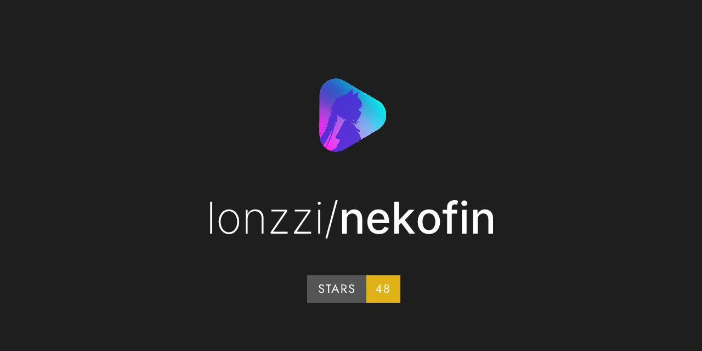
  <p><strong>Your self-hosted media library in your pocket.</strong></p>
  <p>An iOS and Android client for Jellyfin and Emby · Expo · React Native · MPV</p>
</div>

Nekofin connects to your self-hosted media servers so you can browse movies and shows, search your library, explore details, and pick up where you left off with MPV. It also supports multiple server accounts, synced playback progress, audio and subtitle track selection, danmaku (on-screen comments), and light and dark themes.

## App preview

Take a look around the app. Posters and library content depend on the media server you connect to.

<div align="center">
<table width="100%">
  <tbody>
    <tr>
      <td align="center" valign="top" width="25%">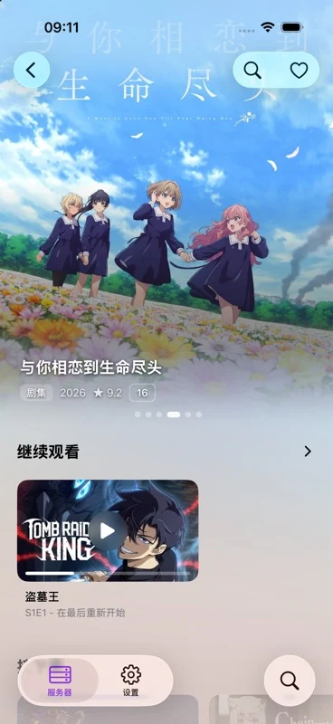<br /><sub>Library · Light</sub></td>
      <td align="center" valign="top" width="25%">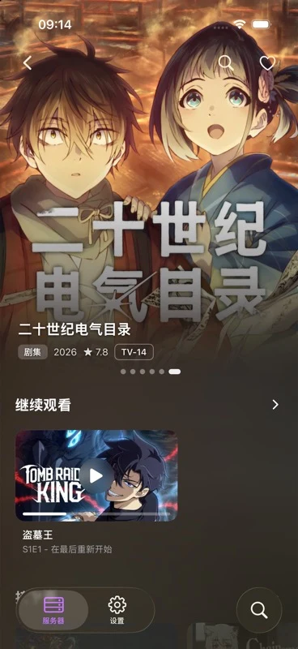<br /><sub>Library · Dark</sub></td>
      <td align="center" valign="top" width="25%">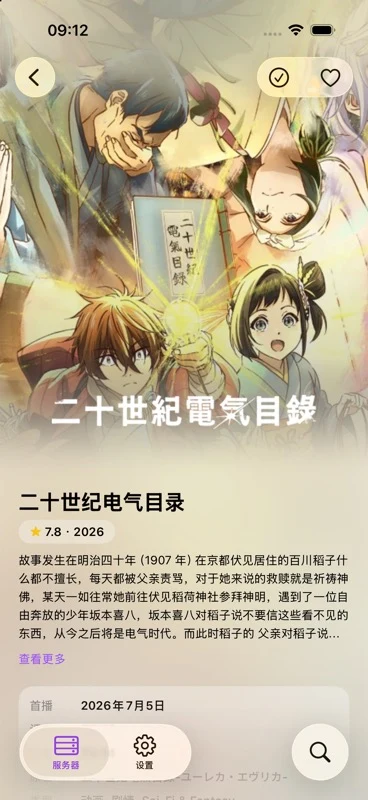<br /><sub>Series details</sub></td>
      <td align="center" valign="top" width="25%">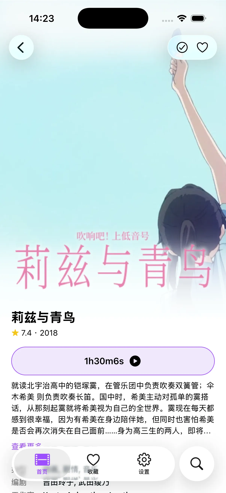<br /><sub>Movie details</sub></td>
    </tr>
    <tr>
      <td align="center" valign="top" width="25%">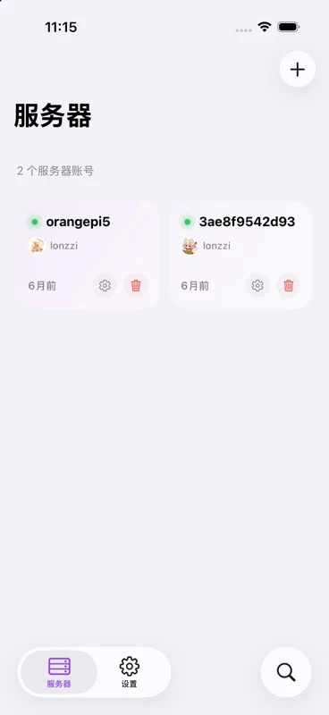<br /><sub>Server management</sub></td>
      <td align="center" valign="top" width="25%">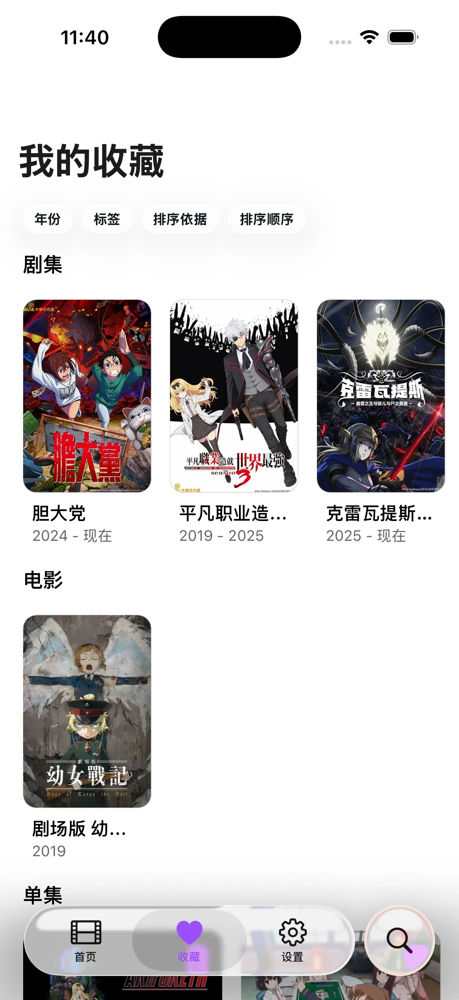<br /><sub>Favorites</sub></td>
      <td align="center" valign="top" width="25%">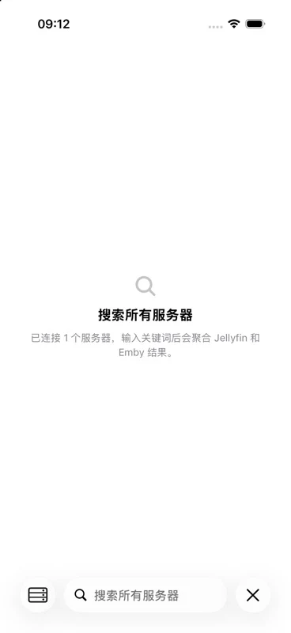<br /><sub>Cross-server search</sub></td>
      <td align="center" valign="top" width="25%">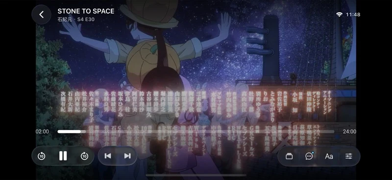<br /><sub>MPV player</sub></td>
    </tr>
    <tr>
      <td align="center" valign="top" width="25%">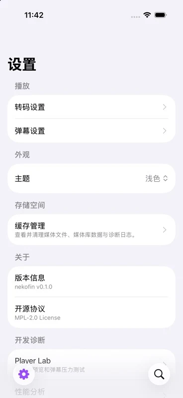<br /><sub>Settings</sub></td>
      <td align="center" valign="top" width="25%">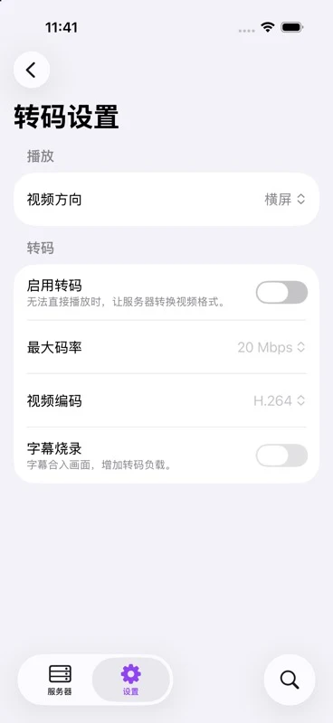<br /><sub>Transcoding settings</sub></td>
      <td align="center" valign="top" width="25%">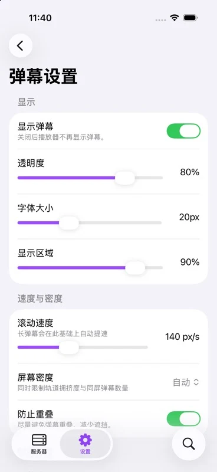<br /><sub>Danmaku settings</sub></td>
      <td align="center" valign="top" width="25%">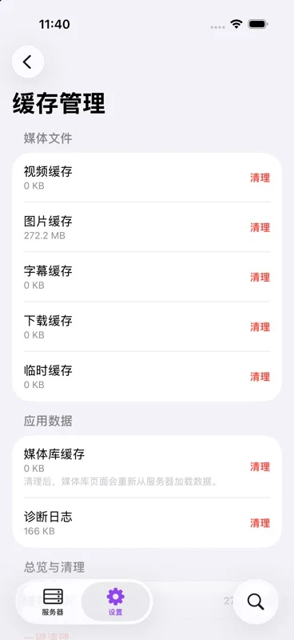<br /><sub>Cache management</sub></td>
    </tr>
  </tbody>
</table>
</div>

## Features

- **Connect your library**: Manage multiple Jellyfin and Emby accounts, and browse movies, shows, favorites, and continue watching
- **Find something to watch**: Search the current server or all connected media servers
- **Explore details**: View movie, show, and episode information, and manage favorites and watched status
- **Continue watching**: Sync playback progress with the MPV player, and choose audio tracks, subtitles, playback speed, and aspect ratio
- **Customize danmaku**: Search for on-screen comments and adjust the font, opacity, speed, display area, and density
- **Choose your theme**: Use a light or dark theme, or follow your system settings
- **App updates**: Go to “Help and about → Check for updates” to check for both app and resource updates, with an option to download automatically. On Android, updates download in the background before prompting you to install; reminders wait until playback ends

> The default danmaku API provides Chinese-language comments only.

## Getting started

Download an available build from [GitHub Releases](https://github.com/lonzzi/nekofin/releases). Add your Jellyfin or Emby account, then open a library to browse and search. Open a movie or show to start or resume playback.

## Local development

Requires Bun, plus Xcode for iOS builds. Xcode 27 or later is recommended: apps built with older Xcode versions may have compatibility issues on iOS 27. The project includes a native player and Expo native modules, so use a development client to build and run it.

```sh
bun install
bun run ios:dev
```

Run checks:

```sh
bun run typecheck
bun run test
```

## Tech stack

React Native · Expo · Expo Router · MPV · TypeScript

## Downloads

- **Stable**: [Latest stable release](https://github.com/lonzzi/nekofin/releases/latest)
- **Pre-release**: Builds marked as Pre-release in the [release list](https://github.com/lonzzi/nekofin/releases)
- **iOS sideloading sources**: Add the [stable source](https://github.com/lonzzi/nekofin/releases/download/app-sources/stable.json) or [beta source](https://github.com/lonzzi/nekofin/releases/download/app-sources/beta.json) in AltStore Classic or a version of LiveContainer that supports Sources. These sources become available with the first release that includes source support, then update automatically with each release.

Version tags set the build version and publish an APK, an unsigned IPA, and checksum files. After a successful release, the version number is synced back to `main`. Resource updates are published separately through GitHub Actions. See the [release process](docs/releasing.md) for details.

## Acknowledgments

[Streamyfin](https://github.com/streamyfin/streamyfin) · [Jellyfin](https://jellyfin.org/) · [Dandanplay](https://www.dandanplay.com/) · [expo-libvlc-player](https://github.com/cornejobarraza/expo-libvlc-player)

## License

[MPL-2.0](LICENSE)
