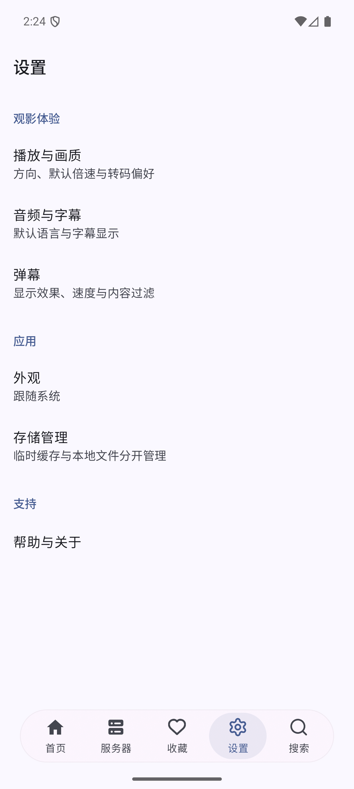
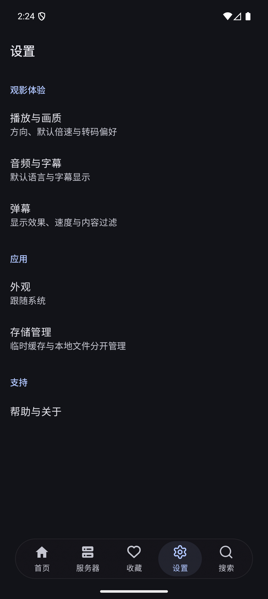
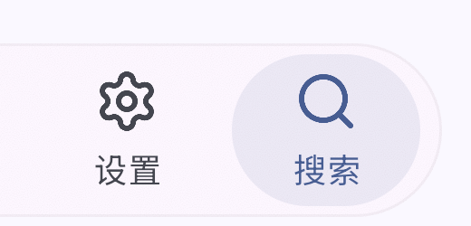
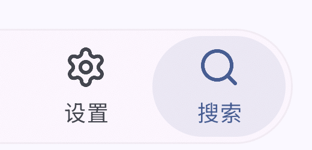

# Android 悬浮底栏

分支：`codex/android-floating-tabs`。

## 源码定位

核对了 Telegram Android 官方仓库和 Nekogram。截图中的底栏属于应用自行绘制的原生导航组件：

- [Telegram MainTabsLayout.java](https://github.com/DrKLO/Telegram/blob/master/TMessagesProj/src/main/java/org/telegram/ui/MainTabsLayout.java)：标签测量、选中状态和手势期间的弹簧动画。
- [Nekogram MainTabsActivity.java](https://github.com/Nekogram/Nekogram/blob/10a8a639a37c262b8a03e504706002f153d76995/TMessagesProj/src/main/java/org/telegram/ui/MainTabsActivity.java#L313-L390)：组装标签，将模糊背景裁成胶囊，限制最大宽度，并将底栏放在系统导航区域上方。
- [Nekogram GlassTabView.java](https://github.com/Nekogram/Nekogram/blob/10a8a639a37c262b8a03e504706002f153d76995/TMessagesProj/src/main/java/org/telegram/ui/Components/glass/GlassTabView.java#L151-L168)：选中背景覆盖整项，圆角为高度一半；选中色透明度为 9%，选中时带缩放动画。
- [Nekogram BlurredBackgroundDrawableViewFactory.java](https://github.com/Nekogram/Nekogram/blob/10a8a639a37c262b8a03e504706002f153d76995/TMessagesProj/src/main/java/org/telegram/ui/Components/blur3/BlurredBackgroundDrawableViewFactory.java)：连接内容捕获源和背景 Drawable，支持液态玻璃效果。

Nekogram 核对版本：`10a8a639a37c262b8a03e504706002f153d76995`。

## NekoFin 的接入

沿用 Expo Router `NativeTabs`、React Native Screens 和 Android Material `BottomNavigationView`。在现有 `react-native-screens@4.26.2` 补丁内调整 Android 视图；原生菜单项继续处理点击、重复选择、路由、徽标和无障碍。

- 透明底栏背景启用悬浮模式；不透明底栏保留原有 Material 外观。
- 胶囊高度 64dp，左右至少留 24dp，最大宽度 440dp；底部距离系统导航区域 8dp。高度随大字体增大。
- `BlurTarget` 仅包含页面内容；独立的 `TabsBackdropView` 采样内容，图标、文字不参与模糊。Android 12 及以上使用现有 BlurView GPU 模糊；较早版本使用接近不透明的底板。
- 自绘 9% 强调色的选中胶囊覆盖图标和文字。普通点击时，旧选中态缩小淡出、新选中态放大淡入（320ms，缩放 0.6–1）；长按时切换为跟随手指的胶囊，松手通过 AndroidX `SpringAnimation` 吸附；遵守系统动画关闭设置。
- 悬浮模式将 Material 的 `itemRippleColor` 设为 `null`，保留选中胶囊，移除点击波纹。
- 页面切换通过原生 Fragment 的 `ObjectAnimator` 完成：按标签方向横向进出，时长 260ms，底栏保持固定。支持 RTL，系统关闭动画时直接切换；连续切换、离开页面和配置变化时清理残留位移。
- 系统导航安全区以底部外边距处理，避免被 Material 再次计入底栏内部；页面底部避让同时包含底栏高度和外边距。
- Android 的图标与标签使用应用主题，五个入口始终显示标签。
- 所有 Android 标签设置 `disableAutomaticContentInsets`，关闭自动内容避让，与首页一致，页面完整铺到底栏后方。`FloatingTabBarInsetProvider` 统一提供滚动内容的末尾留白，随系统底部安全区和字体大小变化，供首页、详情、设置、服务器、收藏和搜索共用。

采用其布局和视觉思路，独立实现 NekoFin 适配。保留 NekoFin 的现有图标与业务入口，未引入 Telegram 的 Lottie 图标、账号头像、长按文件夹菜单和液态折射着色器。

## 验证（2026-10-16）

- `bun install --frozen-lockfile`：通过；确认补丁可在依赖安装时应用。
- `bun run typecheck`：通过。
- `bunx eslint 'app/(tabs)/_layout.tsx'`、`bunx prettier --check 'app/(tabs)/_layout.tsx'`：通过。
- `bun run test -- components/navigation lib/theme smoke/appConfig.smoke.test.ts`：6 个测试文件、23 项测试通过。
- Android prebuild 后运行 `JAVA_HOME='/Applications/Android Studio.app/Contents/jbr/Contents/Home' ANDROID_HOME=/Users/lonzzi/Library/Android/sdk ./gradlew :app:assembleDebug --console=plain`：通过。
- 对 npm 原始 `react-native-screens@4.26.2` 运行 `git apply --check`：通过；`git diff --check`：通过。
- Pixel 9 Pro / Android 16（API 36）模拟器：五个标签逐个点击，核对原生无障碍树的选中状态；结果见 [tab-checks.json](validation/tab-checks.json)。
- 浅色和深色主题、150% 字体：实际检查图标和标签均处于胶囊内。默认字体时胶囊范围为 `(72, 2568)–(1208, 2760)`，内部原生菜单范围为 `(18, 16)–(1118, 176)`；150% 字体时胶囊高度由 192px 增至 228px。
- 搜索键盘打开：输入法确认 `mInputShown=true`，底栏保留在原来的底部位置并被键盘覆盖；键盘收起后可继续选择标签。

首轮发现 Material 内部菜单仍保留 80dp 最小高度，已去除该最小高度，并在测量时重设被 Material 安全区监听器还原的内边距；最终截图已确认图标不再顶到胶囊边缘。

截图：

| 浅色                                       | 深色                                      |
| ------------------------------------------ | ----------------------------------------- |
|  |  |

[150% 字体](validation/font-150.png) · [搜索键盘](validation/search-keyboard.png)

首轮使用未配置媒体账号的开发版验证导航与布局；真实媒体列表滚动时的模糊性能、真机和 Android 11 及以下降级尚未实测。iOS 原生文件的既有补丁保留，未运行 iOS 构建。

## 统一页面底部布局

首版仅首页设置了 `disableAutomaticContentInsets`，其他标签被 NativeTabs 的底部 SafeAreaView 缩短了页面，因此悬浮栏后方会露出固定的空白区域。

本轮把五个标签统一为首页的覆盖方式，保留完整页面背景。滚动末尾的内容避让由 `FloatingTabBarInsetProvider` 统一计算；Compose 设置列表、React Native 列表和通用滚动页都在内容末尾使用这份间距。设置弹窗与 iOS 沿用原来的处理。

验证：

- 类型检查、修改文件的 ESLint 和 Prettier、23 项导航及主题回归通过。
- 模拟器逐个切换首页、服务器、收藏、设置、搜索：原生页面范围全部为 `0,0–1280,2856`，均不再包含 NativeTabs 自动创建的底部 `SafeAreaView`；结果见 [global-inset-checks.json](validation/global-inset-checks.json)。
- 实际检查带有媒体内容的收藏页，以及设置首页、播放设置和弹幕设置；背景均铺到底部。弹幕长列表滚动到底后，“恢复默认设置”完整显示于悬浮栏上方。
- 本轮仅修改 React Native 布局，经开发版热更新验证，未重新构建原生二进制。

[设置页背景延伸到底部](validation/settings-edge-to-edge.png) · [弹幕长列表末尾](validation/danmaku-bottom-edge-to-edge.png)

## 点击反馈和页面过渡

当前底栏由 Android 的 Material `BottomNavigationView` 扩展而来。该控件提供标准底部导航；悬浮玻璃、选中胶囊和整页左右过渡是本项目在原生层增加的效果。参考 [BottomNavigationView 文档](https://developer.android.com/reference/com/google/android/material/bottomnavigation/BottomNavigationView) 与 [Fragment 动画文档](https://developer.android.com/guide/fragments/animate)。

本轮重新构建并覆盖安装开发版，保留原有数据。类型检查、ESLint、Prettier、补丁应用检查、23 项导航及主题回归和 Android `assembleDebug` 均通过。

模拟器录屏逐帧确认页面按方向滑动，底栏保持固定；连续快速选择 13 次后，仅保留一个活动页面，未见残留偏移。关闭系统动画后仍可切换，该轮验证后删除了动画倍率配置；后续复查时发现动画未生效。当前已显式设置为 `animator_duration_scale=1.0`，见下方复查记录。按住未选中标签时，其区域与按压前的截图像素一致，未出现波纹。验证数据见 [tab-motion-checks.json](validation/tab-motion-checks.json)。

[左右切换录屏](validation/tab-slide.mp4)

## 交互与路由复查

上一轮的单个平移选中胶囊并不符合 Telegram 的完整交互。重新对照 `MainTabsLayout` 与 `GlassTabView` 后，改成：

- 普通点击：新旧选中胶囊分别缩放、淡入淡出；图标与文字同步渐变；按压图标缩小并回弹，没有圆形波纹。
- 长按约 375ms：胶囊从当前选中项弹性跟随手指，整条底栏连同玻璃背景放大至 1.019 倍。手指经过的标签显示预览选中态；松手后通过原生菜单操作提交路由，并弹性吸附到该项中心。
- 长按取消：回到已提交的标签。连续点击、移除视图、尺寸变化时清理动画；停止后不持续修改图标 tint，避免空闲重绘循环。
- 该轮曾把 Android 根栈与所有标签内的原生导航栈设为 `slide_from_right`；后续按用户反馈恢复了普通页面的原生默认过渡，见下方记录。播放器的既有单独配置与 iOS 原生过渡保留。

复查发现模拟器的动画倍率配置缺失。显式设为 `1.0` 后，旧版本的原生 tab 过渡恢复，因此此轮验证后保留 `1.0`，不再删除该配置。应用本身仍遵守用户关闭系统动画的设置。

此轮不宣称完整复刻 Telegram 的矢量图标动画和液态折射；已独立实现其选中背景、长按拖动、吸附和页面切换逻辑。

最终验证（Pixel 9 Pro，Android 16 / API 36，开发版）：

- 原生补丁应用、Android `assembleDebug`、类型检查和 23 项导航及主题回归通过；iOS 补丁后缀与原有版本逐字一致，未构建 iOS。
- 录屏逐帧检查“设置 → 播放与画质 → 返回”，以及 tab 双向切换，均包含中间位移帧。
- 长按选中标签后拖到其他项，选中胶囊与文字颜色跟随手指，松手后切换对应页面；长按其他项再拖动提交也通过。
- 13 次快速连点最终选中“设置”；取消拖动后仍停留“设置”；关闭系统动画后仍可切换。结束时倍率明确为 `1.0`，只保留 1 个附着的原生 tab 页面。结果见 [interaction-checks-v2.json](validation/interaction-checks-v2.json)。
- 当前代码已重新构建并覆盖安装，保留模拟器内的原有数据。尚未在真机上验证。

[页面进入与返回录屏](validation/route-motion-v2.mp4) · [长按拖动和点击反馈录屏](validation/tab-gesture-v2.mp4)

## 普通页面恢复原生默认过渡

用户反馈首页进入视频详情的整屏横移动画显得拖沓。撤掉 `platformHeaderOptions.android.tsx` 中全局强制的 `slide_from_right` 配置，普通页面由 native-stack 选择 Android 原生默认过渡。底栏选中、长按拖动和 tab 切换的动画不受这次调整影响。

类型检查、修改文件的 ESLint / Prettier、16 项导航回归通过。通过当前模拟器开发版热更新验证首页媒体卡片进入详情及返回；此轮仅改 JS 导航配置，无需重新编译原生 APK。

[首页进入视频详情及返回录屏](validation/home-default-transition.mp4)

## 内外胶囊弧线对齐

用户截图显示选中背景右侧的间距大于上下间距。原来底栏横向内边距为 6dp，选中背景又各缩进 2dp，形成左右 8dp、上下 4dp；最左／最右选中项的端部圆心因此偏离外层圆心 4dp。

现统一底栏四周内边距为 4dp，选中背景使用原生菜单项的完整宽度，上下边界从同一份内边距取得。背景裁剪、描边和选中胶囊共用 `min(width, height) / 2` 的半径规则；描边按线宽向内取半径。普通点击和长按拖动共用这一绘制逻辑。

Android 原生构建、依赖补丁应用及 `git diff --check` 通过。模拟器分别检查最左首页、长按拖到最右搜索，以及 150% 字体下的最右搜索；端部与上下间距均为 12px（4dp），内外端部圆心重合。字体设置已恢复。

[测量记录](validation/radius-checks.json)

| 调整前                                  | 调整后                                 |
| --------------------------------------- | -------------------------------------- |
|  |  |
