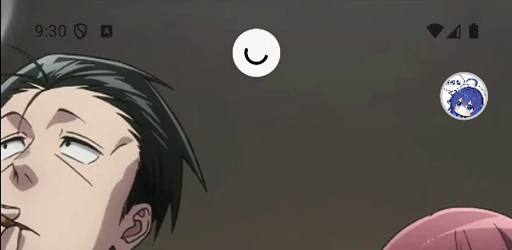
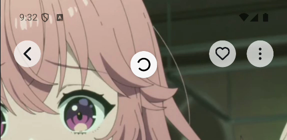

# Android 下拉刷新指示器安全区

首页、服务器媒体首页和视频详情使用透明导航栏，滚动视图从窗口顶部开始。原生 RefreshControl 默认停在距滚动视图顶部 24dp 的位置；Pixel 9 Pro 的刘海／状态栏安全区高 52dp，因此刷新圈会与安全区重叠。

新增 `SafeAreaRefreshControl`，继续使用 React Native 的原生刷新控件。铺到状态栏后方的页面通过 `underStatusBar` 标记，在 Android 将 `progressViewOffset` 设为实时安全区顶部高度。普通网格／列表已经位于不透明的原生导航栏下方，保持默认偏移。调用方手动指定偏移时优先使用该值；iOS 不增加这份补偿。

所有下拉刷新入口均已接入，包括共享媒体首页、三种详情模式，以及 ItemGridScreen 的 SectionList、FlatList 和 ScrollView 分支。刷新请求和页面内容布局保持原有处理。

验证：

- 类型检查、修改文件 ESLint / Prettier、`git diff --check` 通过。
- `bun run test -- hooks/useRefresh.test.ts components/navigation components/home components/detail-view`：11 个文件、51 项测试通过。
- Pixel 9 Pro / Android 16 开发版实际下拉：首页和详情刷新圈稳定停在窗口 y=228–348px，位于 156px 安全区下方。收藏列表滚动区域本来位于 y=324px，刷新圈仍使用本地 y=72px，未重复叠加安全区。原生视图测量见 [refresh-checks.json](refresh-checks.json)。
- 本轮为 JS 配置调整，经 Metro 热更新验证，无需重建 APK；未运行 iOS 构建。

| 首页调整前                 | 首页调整后                |
| -------------------------- | ------------------------- |
|  |  |

