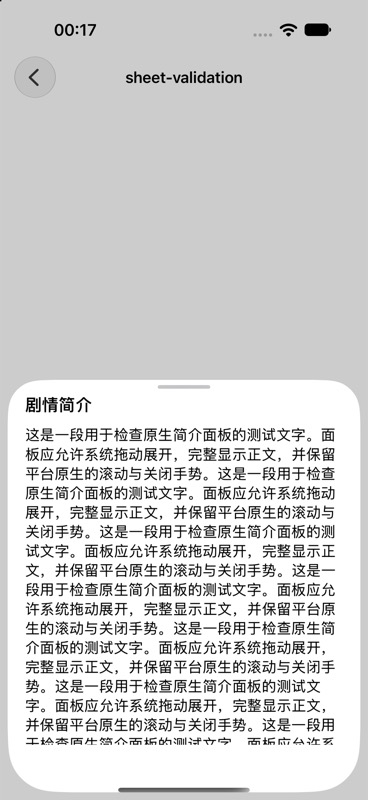
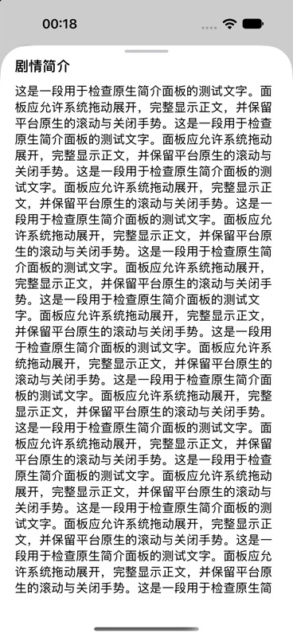
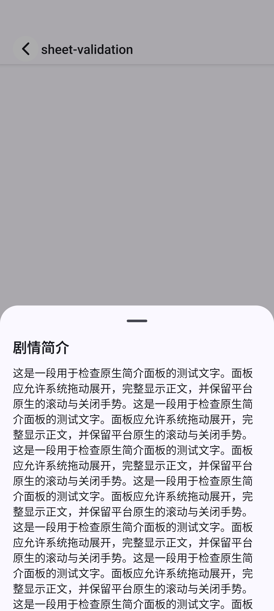
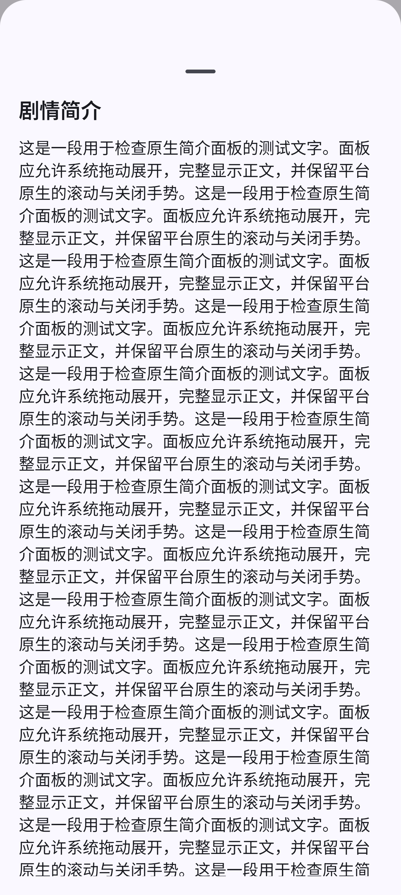
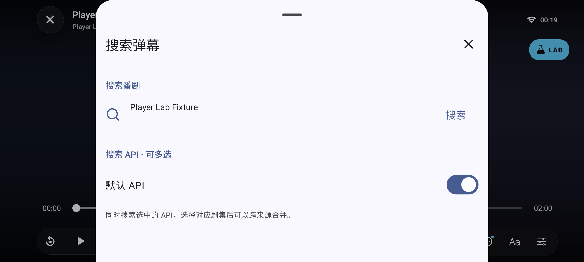

# 原生简介与播放器 Sheet

简介分别使用 `@expo/ui/swift-ui` 的 SwiftUI `BottomSheet`、`ScrollView` 和 `Text`，以及 `@expo/ui/jetpack-compose` 的 Material `ModalBottomSheet`、可滚动 `Column` 和 `Text`。不使用 JS 手势或动画模拟弹层。两端移除“完成”按钮，保留系统拖动关闭；iOS 使用系统 `medium` / `large` 展开档位，正文不再受原先的 70% 窗口高度限制。

Android 简介与播放器面板移除系统拖拽柄之外的额外顶部 padding。播放器的状态栏、导航栏显隐改由 native-stack 的页面选项管理，取消挂载后再调用 NavigationBar 的处理，避免进入页面时两套逻辑竞争。

Compose 的 ModalBottomSheet 使用独立 Dialog 窗口。`@expo/ui@57.0.23` 补丁让它注册 React Native 的额外窗口生命周期，并同步弹出前 Activity 的系统栏可见状态、保持 edge-to-edge。这样搜索面板不再把隐藏的状态栏带回来，导致底层播放器安全区变化。Expo SDK 57 默认可使用预编译模块，因此同时把 Android `expo-ui` 配置为从源码构建，确保 Kotlin 补丁进入 APK。

## 验证

- Android 原生源码构建 `:app:assembleDebug` 通过；确认执行了 `:expo-ui:compileDebugKotlin`，APK 中包含新增方法。
- `bun install --frozen-lockfile`、补丁从原始文件干净应用、`bun run typecheck`、修改文件 ESLint / Prettier、`git diff --check` 通过。
- 基于最新 main 复核 `bun run test`：74 个文件、469 项通过。
- Pixel 9 Pro / Android 16：简介半屏与完整展开均没有“完成”，拖拽柄底部到标题顶端约 22dp，原先约 52dp；检查了系统返回先收起、点击遮罩关闭。
- 使用实际播放器布局、Controls、PlayerPanelHost 与弹幕搜索组件进行隔离测试：打开、关闭及重新打开搜索，系统栏保持隐藏；输入法打开时状态栏仍隐藏，底层播放器根视图与顶部控件坐标保持不变。键盘显示期间导航栏由 Android 输入法显示，关闭键盘和面板后恢复隐藏。搜索面板原生拖动关闭通过。
- iPhone 18 Pro / iOS 27：使用已安装的开发客户端加载当前工作区代码，实际验证 SwiftUI 简介从半屏拖至完整高度、向下收起和关闭，无“完成”按钮。本轮没有重新构建 iOS 原生应用。

测试使用长文本简介及 Player Lab 临时路由，验证后均已删除。另从首页启动真实媒体，确认成功开始播放，播放器状态栏与导航栏均隐藏；隔离测试不包含解码验证，未做长时间播放和真机测试。测量记录见 [checks.json](validation/checks.json)。

| iOS 半屏                                      | iOS 完整展开                                      |
| --------------------------------------------- | ------------------------------------------------- |
|  |  |

| Android 半屏                                          | Android 完整展开                                          |
| ----------------------------------------------------- | --------------------------------------------------------- |
|  |  |

