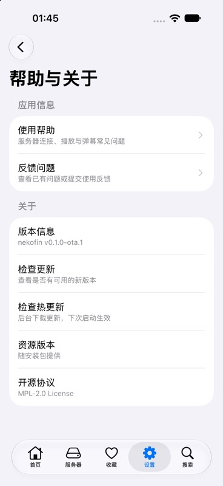

# GitHub + Vercel OTA 验证

验证日期：2026-10-18（Asia/Shanghai）。客户端代码：`57b559c`。使用完整应用的 iOS Release 构建，未替换播放器。

## 实际客户端流程

设备：iPhone 18 Pro 模拟器，iOS 27。原生安装包：`v0.1.0-ota.1`，渠道：`preview-v0.1.0-ota.1`。

1. 启动原生安装包，关于页显示资源版本「随安装包提供」。
2. 发布签名资源到 GitHub Release `ota-preview-smoke-20261018-2`，由生产 Vercel 接口分发清单。
3. 手动检查热更新，客户端完成下载并显示「更新已准备好，下次启动生效」。资源版本仍为内置，当前页面没有重载。
4. 停止并重新启动同一个 App，未重新安装。关于页资源版本变为 `8add2901`，安装包版本仍为 `v0.1.0-ota.1`。
5. 发布签名 `rollBackToEmbedded` 指令，手动检查后仍运行 `8add2901`。
6. 再次冷启动后恢复「随安装包提供」，应用正常运行。测试渠道最终保持回退状态，未向 production 渠道发布测试资源。

| 内置资源                     | 下载完成，尚未应用             | 重启后应用                    |
| ---------------------------- | ------------------------------ | ----------------------------- |
|  |  |  |

| 回退已准备好，仍运行 OTA               | 冷启动后恢复内置资源          |
| -------------------------------------- | ----------------------------- |
|  |  |

## 运行时与资源

| 平台    | 原生运行时指纹                             | 测试更新 ID                            | 资源数（含 bundle） |
| ------- | ------------------------------------------ | -------------------------------------- | ------------------- |
| iOS     | `b37a1788f5ff3f1a149327114be2fa963959e807` | `8add2901-e111-49e2-9128-a496dfacd711` | 44                  |
| Android | `3d106442e688fdf23cf42391545e922e676a4ddf` | `da9bc839-441c-4212-93b5-b56afe3174c2` | 54                  |

已导出双端 Hermes bundle，并验证 GitHub 资源的签名和逐文件 SHA-256。iOS 模拟器实际通过原生 expo-updates 下载、应用及回退。Android 已检查 prebuild 配置、运行时契约和发布资源，尚未在 Android 设备运行；iOS 真机侧载也尚未验证。

运行时检查确认：修改客户端 JS 不改变指纹；修改本地 Swift 原生代码会改变指纹。构建配置与客户端检查逻辑分离，防止普通 JS 修复被误判为原生变更。

## 回归与构建

- `bun run test`：87 个文件、564 项通过。
- `bun run typecheck`：通过。
- `bun run test:ota`：18 项通过，覆盖协议、签名、资源准备、运行时隔离及旧版回退。
- `node --test .github/scripts/*.test.cjs`：29 项通过。
- iOS Release arm64 模拟器构建与运行：通过。
- GitHub PR 的 OTA validate job：通过；publish job 只在手动 dispatch 时执行。

生产服务：<https://nekofin-updates-ronki.vercel.app/api/manifest>。日常发布步骤与首次安装要求见 [更新说明](../../app-updates.md)。
